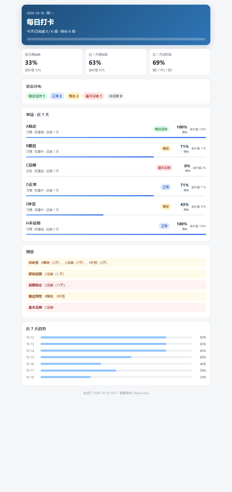

# 每日打卡与完成评估

一个放在本地 Excel 里的每日打卡系统：每天固定时间提醒，给事项打勾，自动生成完成率、状态判定和手机可看的报告。

所有数据都留在本机。仓库只包含程序、说明和默认提示音，不包含任何打卡记录。

## 功能

- **Excel 打卡表**：事项为行、日期为列，脚本每天自动补上今天的日期列。
- **四态打勾**：✅完成 / ❌未做 / ➖不适用 / 🩹补签，空白表示待补签。
- **每日提醒**：默认每天 22:00 在屏幕右下角显示卡片，并播放提示音；点击卡片打开表格。
- **错过补发**：电脑关机或休眠错过时，登录后补发一次；同一天只提醒一次。
- **自动评估**：近 7 天原始完成率、含补签完成率、连续完成/中断、待补签、超期锁定。
- **状态判定**：稳定坚持 / 正常 / 懈怠 / 基本没做 / 待观察。
- **加权完成率**：高=3、中=2、低=1，重要的事在整体完成率里占更大分量。
- **完成记录**：事项状态改为“已完成”后停止统计，自动归档。
- **回收站**：状态改为“已删除”后进入回收站；改回“进行中”即可恢复。
- **手机报告**：每次评估生成 `report.html`，可直接发到手机查看。
- **自动备份**：每次写回前备份到 `backup/`，保留最近 14 份。

## 环境要求

- Windows 10 / 11
- Microsoft Excel（WPS 未完整测试；数据校验和条件格式可能需要 Excel 才能完整显示）
- Windows PowerShell 5.1（系统自带）
- 不需要安装第三方软件；计划任务使用当前用户权限，不需要管理员

## 快速开始

1. 把整个文件夹放到一个固定目录，例如 `C:\DailyCheckin` 或 `%USERPROFILE%\Documents\DailyCheckin`。
2. 双击 `安装提醒任务.cmd`，注册每天 22:00 的计划任务（只需一次）。
3. 双击 `测试提醒.cmd`，确认右下角出现提醒卡片并播放提示音。
4. 双击 `打开今日打卡.cmd`，开始填写事项并打勾。也可以为它创建桌面快捷方式。
5. 需要调整语音音量时，双击 `调整音量.cmd`，输入 0–100。

第一次运行会自动生成 `checkin.xlsx`，并预置 3 个示例事项，直接改名即可。

## 默认时间与配置

配置文件是 `config.json`：

| 字段 | 默认值 | 说明 |
|---|---|---|
| `graceDays` | `7` | 补签窗口天数 |
| `maxItems` | `12` | 建议事项上限（提示用） |
| `reminderTime` | `"22:00"` | 每日提醒时间 |
| `keepSeconds` | `45` | 提醒卡片停留秒数 |
| `notifyMode` | `"window"` | `"window"` 右下角卡片；`"balloon"` 系统气泡 |
| `playSound` | `true` | 是否播放提示音 |
| `voiceFile` | `"ding.wav"` | 提示音文件 |
| `voiceVolume` | `70` | 提示音音量 0–100 |

修改 `reminderTime` 后，需要重新双击一次 `安装提醒任务.cmd`，让计划任务使用新时间。

## 可选：自定义提醒语音

仓库默认只带一个短提示音 `ding.wav`。如果想让提醒播放自己的语音：

1. 准备一个 **16-bit PCM WAV** 文件，命名为 `voice.wav`，放在脚本同目录。
2. 把 `config.json` 的 `voiceFile` 改成 `"voice.wav"`。
3. 双击 `调整音量.cmd` 试听并调整音量。

仓库不附带动漫角色语音。若使用 VOICEVOX 等工具生成语音，请自行遵守对应引擎和角色音源的使用条款。

## 文件说明

| 文件 | 作用 |
|---|---|
| `checkin.xlsx` | 自动生成的打卡主表（不纳入版本控制） |
| `report.html` | 自动生成的手机只读报告（不纳入版本控制） |
| `config.json` | 提醒时间、补签窗口、音量等配置 |
| `notify.ps1` | 提醒入口：评估、卡片、提示音、补发判断 |
| `evaluate.ps1` | 单独运行评估，并把结果写入表格 |
| `prepare.ps1` | 补日期列、刷新评估并打开表格 |
| `setup-task.ps1` | 生成并注册计划任务 |
| `set-volume.ps1` | 调整提示音音量 |
| `check-task.ps1` | 检查计划任务状态，生成 `诊断结果.txt` |
| `lib/` | 表格读写、统计、渲染、报告、音频模块 |
| `ding.wav` | 默认提示音 |
| `使用说明.html` | 完整使用说明（可用浏览器打开） |
| `docs/自测记录.md` | 自动化测试记录 |

## 数据与隐私

以下内容已写入 `.gitignore`，不会被提交：

- `checkin.xlsx`（个人打卡数据）
- `backup/`（历史备份）
- `log.txt`、`state.json`、`cache.json`
- `report.html`、`诊断结果.txt`
- `tasks/`（含本机绝对路径和用户 SID 的任务 XML）
- `*.lnk`（本机快捷方式）
- `voice.wav`（自定义语音）

如果你 fork 或修改本项目，提交前请确认没有把这些文件加入版本控制。

## 已知限制

- 表格正被 Excel 打开时，脚本无法写回，只能显示上次快照；关闭表格后下一次提醒或打开时会补写。
- 脚本重写表格时会按模板重排，额外添加的批注、颜色可能被重置；数据本身不受影响。
- 电脑关机时无法在 22:00 执行任务，只能在下次登录后补发；休眠时可在任务计划里开启“唤醒计算机运行此任务”。
- 手机端默认是只读报告；如需手机直接打勾，需要自行配置 OneDrive 等同步盘，并注意并发编辑冲突。

## 说明

这个项目使用系统自带的 .NET、PowerShell 和 Excel 文件格式实现，运行时不需要联网。可选的语音生成、GitHub 上传等步骤不属于日常运行的一部分。
